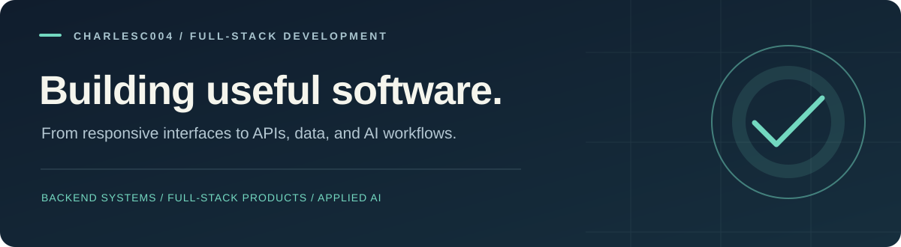

### Full-stack developer · Backend systems · Applied AI

I build web applications that connect useful interfaces with APIs, persistent data, and practical automation.

[**Explore my project collection →**](https://github.com/charlesc004/all-projects) &nbsp;·&nbsp; [Browse repositories](https://github.com/charlesc004?tab=repositories)

## About my work

My projects cover SaaS workspaces, CRM, customer support, booking, e-commerce, business intelligence, and AI-powered knowledge tools. I focus on connecting the whole product: user flows, backend logic, permissions, data models, and operational visibility.

I work with **TypeScript, C#, and Python** across frontend and backend development, and explore event-driven services and ML inference through projects such as SentinelML.

## What I work with

| Focus | Technologies & practices |
| :--- | :--- |
| Backend development | C#, ASP.NET Core, Python, FastAPI, Node.js, NestJS, Express, REST APIs |
| Frontend development | TypeScript, React, Next.js, Vue, Nuxt, Angular, Blazor, Tailwind CSS |
| Databases & persistence | PostgreSQL, SQL Server, MongoDB, Redis, Prisma, SQLAlchemy, EF Core |
| AI & automation | RAG, pgvector, LangGraph, agent workflows, human approvals, ONNX inference |
| Engineering workflow | Git, Docker, GitHub Actions, Playwright, pytest, Vitest, automated testing |

## Selected projects

| Project | Focus | Core stack |
| :--- | :--- | :--- |
| [**AgentCore AI**](https://github.com/charlesc004/agentcore-ai) | Visual AI workflows with specialized agents, human approvals, and execution monitoring. | Next.js · React · TypeScript · React Flow · FastAPI · SQLAlchemy |
| [**SYNQRA AI**](https://github.com/charlesc004/synqra-ai) | Search documents, ask questions with cited answers, and run human-approved knowledge workflows. | Next.js · TypeScript · FastAPI · PostgreSQL / pgvector · LangGraph |
| [**SentinelML**](https://github.com/charlesc004/SentinelML) | Event-driven fraud detection with model inference, risk policies, and analyst investigations. | Go · Rust / ONNX · Rails · Next.js · Python · Redpanda |
| [**TICKORA**](https://github.com/charlesc004/Tickora-helpdesk) | A support workspace for tickets, team conversations, SLA tracking, and operational reporting. | C# · ASP.NET Core · Blazor · EF Core · SQL Server · SignalR |
| [**Nexus CRM**](https://github.com/charlesc004/Nexus-Crm-SaaS) | Organization-scoped customer relationship management with leads, deals, tasks, and reporting. | Next.js · TypeScript · NestJS · Prisma · PostgreSQL |
| [**PRISM**](https://github.com/charlesc004/Prism-BI-platform) | Business intelligence for connected commerce data, background synchronization, and interactive reporting. | Angular · TypeScript · Node.js · PostgreSQL · Prisma · Redis · BullMQ |
| [**SERENO Studio**](https://github.com/charlesc004/sereno-booking-platform) | Appointment booking and studio operations with availability rules, team schedules, and customer records. | Vue · TypeScript · Vite · FastAPI · SQLAlchemy · PostgreSQL |
| [**VELORA**](https://github.com/charlesc004/Velora-e-commerce-platform) | Fashion storefront and administration workspace with catalog, inventory, and test checkout flows. | React · TypeScript · Vite · Express · MongoDB |

### Web & interface projects

- [**AVENOR**](https://github.com/charlesc004/Avenor-worpress-website) — a custom WordPress publishing website built with PHP, Gutenberg, and JavaScript.
- [**f-society**](https://github.com/charlesc004/f-society) — a Nuxt / Vue application with authentication screens and a dashboard.

---

**Explore the code behind the work.**

[All projects, descriptions & technology stacks](https://github.com/charlesc004/all-projects)

